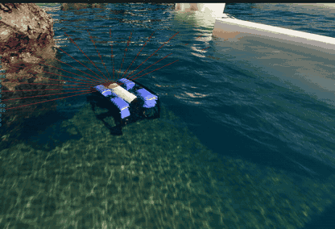
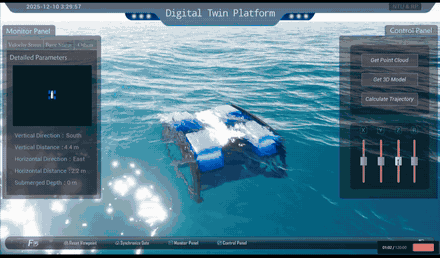
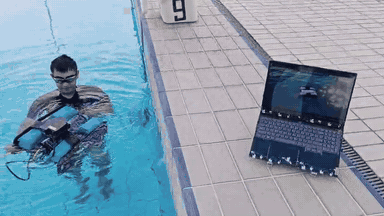

# Underwater ROV Digital Twin and Learning-Based Control

MSc dissertation project at Nanyang Technological University, Singapore (Aug 2025–May 2026).

I designed the system architecture and built an Unreal Engine 5 digital twin for an underwater remotely operated vehicle (ROV). The simulator models ROV hydrodynamics and underwater environmental effects for controller development and reinforcement learning experiments. I trained TD3 policies in simulation to generate continuous control commands for obstacle avoidance.

## TD3 obstacle avoidance in simulation

<picture>
  <source type="image/avif" srcset="td3-preview.avif">
  
</picture>

## UE5 underwater simulation

<picture>
  <source type="image/avif" srcset="ue5-preview.avif">
  
</picture>

## ROV digital twin pool test

<picture>
  <source type="image/avif" srcset="digital-twin-preview.avif">
  
</picture>

